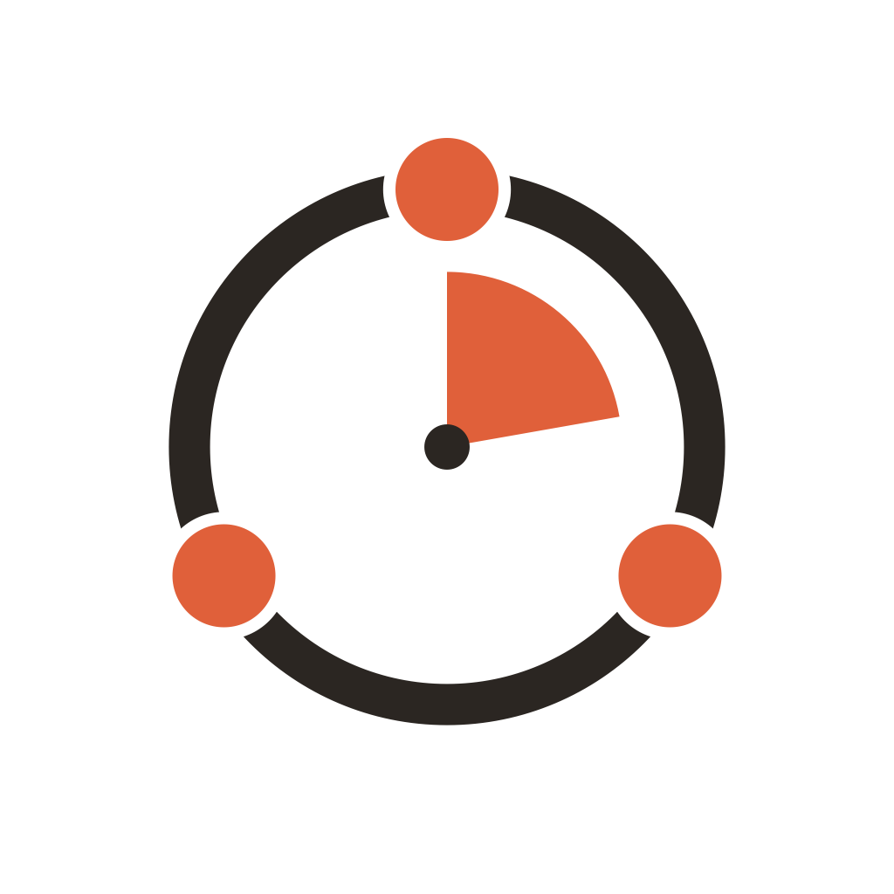

<p align="center">
  
</p>

<h1 align="center">Gather</h1>

<p align="center"><b>不用投票，也能约到大家都有空的时间。</b><br/>
每个人用自己的话说什么时候有空、想怎么玩，Gather 帮你整理成一个大家都能接受的方案。</p>

---

## Gather 能帮你做什么

在群里发投票约时间，常常会遇到这些麻烦：

- 投票只能选"周四晚上"或"周五晚上"，没法说"周四可以，但要 7 点以后"。
- 吃什么、预算多少、谁有忌口，只能另外在群里问，回复散得到处都是。
- 有人一直不回，有人说"看情况"，最后还是得一个个私聊。

用 Gather 的话，**大家像平常聊天一样回复就行**：

> "周四周五晚上都行，周四要 7 点以后。想吃日料，别太贵，对花生过敏。"

Gather 会读懂每一条回复，算出最多人能来的时间，再结合大家的偏好给出两三个方案。有人来不了的话，它还会私下问问对方能不能调整一下。

---

## 目录

- [参与者：怎么回复](#参与者怎么回复)
- [组织者：怎么发起和定下来](#组织者怎么发起和定下来)
- [和 Gather 私聊](#和-gather-私聊)
- [写回复的小技巧](#写回复的小技巧)
- [常见问题](#常见问题)
- [不用 Slack 也能用：网页版](#不用-slack-也能用网页版)
- [安装到你的 Slack](#安装到你的-slack)

---

## 参与者：怎么回复

### 1. 在帖子里用自己的话回复

频道里会出现一条活动消息。点开它下面的帖子（thread），像平常说话一样告诉 Gather 你什么时候有空、有什么想法。中文、英文都可以。

**不想点开帖子？** 直接在频道里 **@Gather** 说也行，比如"@Gather 周三晚上 7 点以后可以"，会算作对这个频道最新活动的回复。

**忘了 @Gather，直接在频道里回了？** 没关系。如果你的消息听起来像在回复活动（提到了星期几、几点、有没有空），Gather 会弹一条**只有你能看到**的提示，问你"这是对某某活动的回复吗？"。点 **✅ Yes, count it** 就算进去，点 **No** 提示就消失，什么都不会保存。普通聊天它不会理会。

**同一个频道里有好几个活动在收集？** 这时 @Gather 或者直接在频道里回复，Gather 不会去猜是哪个，而是弹出提示让你选。同样，如果你同时欠好几个活动的回复（比如都收到了提醒），在私聊里回复时它也会先问你是哪个活动。在活动帖子里回复则永远不会弄混。

<p align="center"></p>

### 2. 说得不够清楚时，Gather 会追问一句

比如你只说了"想吃披萨"，没说时间，Gather 会在帖子里 @ 你问一句。最多问两次，不会没完没了。

<p align="center"></p>

### 3. 看一眼确认卡片

Gather 读懂之后，会在你的回复上打一个 ✅，并发给你一张"我理解的是……"的卡片：你哪几天、几点到几点有空，有什么必须注意的（比如过敏），有什么偏好。**这张卡片只有你自己能看到。**

<p align="center"></p>

**理解错了，或者计划变了？** 在帖子里再回一句就行，比如"其实周五更好"，Gather 会更新你的回答。

### 4. 不想在群里说？私聊 Gather

有些事不想公开说，比如"那天要去看医生""我不喝酒"。直接私聊 Gather，效果和在帖子里回复一样。如果你同时在好几个活动里，它会先问你是哪一个。

<p align="center"></p>

### 5. Gather 可能会私下问你能不能调整

如果大部分人都选了一个你来不了的时间，Gather 可能会私聊你问一句，比如："大家倾向周五 7–9 点，你之前说要 8 点前走，有没有可能晚一点？"你可以点 **Yes** 或 **No**，也可以直接打字回复。**完全没有压力，说不行也没关系。**

<p align="center"></p>

---

## 组织者：怎么发起和定下来

### 1. 发起活动（两种方式）

**方式一：用表单。** 在频道里输入：

```
/gather 实验室聚餐
```

填一下日期范围、每天的时间段、大概多长，以及除了时间还想问大家什么（吃什么、预算、忌口……），点 **Post to channel**。

<p align="center"></p>

**方式二：私聊 Gather 一句话。** 比如：

> "Plan a happy hour next week in #social, evenings, about 2 hours"

Gather 会把日期、时间段、时长都填好，给你看一眼，还会让你从下拉菜单里选要发到哪个频道。

- 没问题就点 **✅ Post it**。
- 想改的话，**直接回一句话**就行，比如"全部用英文""改成 3 小时""再问问大家的预算"。Gather 改完会再给你看一次。
- 也可以点 **✏️ Edit first** 打开表单手动改。关掉表单不会丢失草稿，随时可以再打开。

<p align="center"></p>

> 如果是私有频道，先输入 `/invite @Gather` 把 Gather 拉进去。

### 2. 等大家回复

活动消息底部会实时显示谁已经回复了。你什么都不用做，Gather 会自己读回复、追问说得不清楚的人。

**有人一直没回？** 点活动消息上的 **⋯** → **🔔 Remind who hasn't replied**。Gather 会私聊频道里还没回复的人提醒一下，对方直接在私聊里回复就会被收集。同一个人 12 小时内不会被重复提醒。

**计划有变？** 点 **⋯** → **🚫 Cancel this event**，确认后活动会标记为已取消，不再收集回复。

发起活动后，Gather 还会私下发给你一个**网页面板**链接。面板上有一张"谁什么时候有空"的热力图，以及每个人回复的完整摘要。

<p align="center"></p>

### 3. 生成方案

觉得回复差不多了，点活动消息上的 **✨ Generate plan**。Gather 会在帖子里给出两三个方案，每个方案都写明：

- **什么时候**，几个人能来，谁来不了
- **为什么**推荐这个时间
- **取舍**：选这个方案会牺牲什么
- **活动建议**：比如去什么类型的店、预算多少，同时照顾到忌口

<p align="center"></p>

人更多之后，可以再点一次，方案会根据最新的回复更新。

### 4. 问问来不了的人（可选）

如果最佳时间还有人来不了，点 **🤝 Ask the people who can't make it**。Gather 会分别私聊这些人，根据他们之前说的情况问能不能调整，比如"你之前说要 8 点前走，有没有可能晚一点？"。他们的回答会私信告诉你。有人答应了，再点一次 **✨ Generate plan**，方案就会更新。

### 5. 宣布决定

选好方案后，点 **📣 Announce top pick**（或者其他方案的 Announce 按钮）。Gather 会在频道里正式宣布时间和安排，活动消息会标记为"已决定"，之后不再收集回复。

宣布消息下面带 **📅 Add to Google Calendar** 和 **📅 Add to Outlook** 两个按钮，大家点一下就能把活动加进自己的日历，时间和时区都已经填好。

<p align="center"></p>

> 只有发起活动的人能生成方案、私聊协商和宣布决定。其他人点这些按钮时，会收到一条只有自己能看到的提示。

### 想先自己试试？用虚拟参与者

不用拉别人进来，一个人就能把整个流程走一遍：

1. 点活动消息上的 **⋯** → **🧪 Add 5 test replies**。Gather 会加入 5 个虚拟参与者的回复，名字后面带 "(sim)"。他们说话方式各不相同：有人给条件，有人说得模糊，有人带着忌口，用中文、英文的都有。多点几次，最多可以加 12 个。
2. 点 **✨ Generate plan** 看方案。
3. 如果有虚拟参与者来不了，点 **🤝 Ask the people who can't make it**。虚拟参与者收不到私信，所以 Gather 会把问答直接显示在帖子里。他们各有"性格"：有人爽快答应，有人只能晚到半小时，有人婉拒。
4. 再点一次 **✨ Generate plan**，能来的人会变多。
5. 点 **📣 Announce top pick** 宣布决定。

虚拟参与者的回复和真人一样，由 AI 来理解。所以这也是检查 Gather "听不听得懂"的好办法。

---

## 和 Gather 私聊

在 Slack 左侧的 **Apps** 里点 **Gather**，就可以直接和它对话。它能听懂这些事：

| 你想做什么 | 可以这样说 |
|---|---|
| 私下回复一个活动 | "Thursday after 7 works, I'm vegetarian" / "周四晚上可以，但我对花生过敏" |
| 发起一个新活动 | "Plan a karaoke night next Friday in #social, 8pm to midnight" |
| 问问活动的情况 | "Who has replied to the happy hour?" / "我之前是怎么回复的？" |
| 告诉它你的习惯 | "回复我用中文，但是发布的活动用英文" / "I usually post in #social" |
| 看看它记住了什么 | "你记住了我什么？" / "What do you remember about me?" |
| 看看能做什么 | "help" |

### Gather 会记住你的习惯

你在私聊里顺口说过的习惯，Gather 会记下来，以后自动照办。比如：

- "回复我用中文，但是 post 的信息用英文"：以后回复你用中文，你发起的活动默认用英文写。
- "我一般都发到 #social"：以后发起活动时，频道默认就是 #social，不用每次都选。
- "I usually do 2-hour events"：以后没说时长的话，默认 2 小时。

几点说明：

- **记住的时候会告诉你**，比如"📝 我记住了：回复你用中文；发布的活动用英文"，不会悄悄地记。
- **只记长期习惯。** 只针对这一次的修改（比如"这个改成 3 小时"）不会被当成习惯。
- **每个人分开记。** 你的习惯只影响你自己，不会影响其他人。
- 想查看就问"你记住了我什么？"，想清除就说"忘掉我的偏好"。

---

## 写回复的小技巧

Gather 能听懂很多种说法，下面这些写法效果最好：

- **说清楚哪几天、几点之后或几点之前**："周四 7 点以后""Friday, but I have to leave by 9"
- **排除式也可以**："这周除了周三都行"
- **表达倾向**："周五最好""周四也行，实在不行的话"，Gather 会区分"最想要"和"勉强可以"
- **把必须注意的事说出来**：过敏、素食、不喝酒、行动不便……这些会被标成"必须遵守"，方案会照顾到
- **偏好随便说**："想吃日料""别太贵""有精酿就好"

---

## 常见问题

**谁能看到我的回复？**

| 内容 | 谁能看到 |
|---|---|
| 你在帖子里写的原话 | 频道里所有人（和普通的帖子回复一样） |
| 你私聊 Gather 的内容 | 只有你和 Gather |
| 确认卡片 | 只有你自己 |
| 你回复的摘要（时间、约束、偏好） | 组织者，在网页面板和方案里 |
| 谁已经回复了 | 频道里所有人（只显示名字） |

**支持哪些语言？** 中文、英文、日文、西班牙文等都可以，混着写也行。在 Slack 里，Gather 会用你写的语言回复你；网页版界面和 Gather 的回复都是英文，但你用任何语言写它都能看懂。

**Gather 没反应怎么办？**
- 私有频道需要先输入 `/invite @Gather`。
- 请回复在活动消息的帖子里，或者在频道里 @Gather。直接在频道里说的话，要在弹出的提示里点 "Yes, count it" 才会算进去。
- 活动宣布或取消之后就不再收集回复了。
- 如果都不是，可能是 Gather 暂时下线了，请联系安装它的人。

**定下来之后还能改吗？** 宣布之后活动就关闭了。需要重新约的话，再发起一个新活动就行。

**要花钱吗？** 对参与者和组织者都是免费的。

---

## 不用 Slack 也能用：网页版

没有 Slack 的群（比如微信、WhatsApp 群）也可以用 Gather 的网页版：在首页创建活动，把参与者链接发到群里，大家点开链接用一句话回复。组织者通过自己的私密链接查看热力图、生成方案，再把 Gather 写好的通知复制回群里。

**网页版也能一对一沟通。** 在 Slack 里，Gather 用私聊找到每个人；网页版的对应做法是**每人一个私人页面**：

- 参与者提交后，Gather 会给他一个私人页面，相当于和 Gather 的私聊：能看到自己的回答，计划变了直接打字更新。**不用保存任何网址**：设备会记住他，之后再点开群里的活动链接，就会提示"欢迎回来"并带他回到私人页面。
- **My Gather**（网站的 `/me` 页面）列出这台设备回复过的所有活动，每个活动显示状态：已回复、Gather 有问题要问你、已定下来。参与者页面右上角有入口。这些记录只存在那台设备的那个浏览器里，换设备或清除浏览器数据就看不到了；在微信里打开的链接，记录存在微信内置浏览器里。
- 组织者点 **🤝 Ask N people** 时，Gather 会把"大家倾向周五 7–9 点，你能调整一下吗？"这样的问题发到每个来不了的人的私人页面上。对方可以点 **Yes / No**，也可以直接打字回答，组织者面板上会实时显示每个人的状态（等待回答 / 能来了 / 来不了）。
- 网页没法像 Slack 那样主动推送通知。所以面板上每个还没回答的人旁边有一个 **Copy a reminder to send them** 按钮，复制一段带私人链接的提醒，组织者私聊发给对方即可。参与者也可以在私人页面上留下联系方式（微信号、邮箱等），只有组织者能看到。
- 组织者选定方案后点 **📣 Pick this one**，活动关闭，所有人打开活动链接或私人页面都会看到最终安排。

网页版可以部署到 Cloudflare Workers，得到一个公开网址，不用在自己电脑上运行。步骤见 [开发文档](docs/DEVELOPMENT.md#部署网页版到-cloudflare-workers)。

网页面板上同样可以点 **🧪 Add 5 test replies** 加虚拟参与者，生成方案后，也能让来不了的虚拟参与者回答"能不能调整"。

---

## 安装到你的 Slack

打开 **[Gather for Slack](https://gather.psc-docket-helper.workers.dev/slack)**，点 **Add to Slack**，按 Slack 的提示同意授权，就装好了。不需要安装任何软件，也不需要自己运行服务器。

- 有的 workspace 需要 Slack 管理员批准才能安装应用。
- 装好之后，在任意频道输入 `/gather`，或者在左侧 **Apps** 里找到 Gather 直接私聊。
- 每个 workspace 的数据单独存放，别的组织看不到你们的活动和回复。
- 想移除的话，在 workspace 的应用设置里卸载 Gather 即可，卸载后立刻停止工作。

想自己部署一份 Gather，或者参与开发，见 **[开发文档](docs/DEVELOPMENT.md)**。
