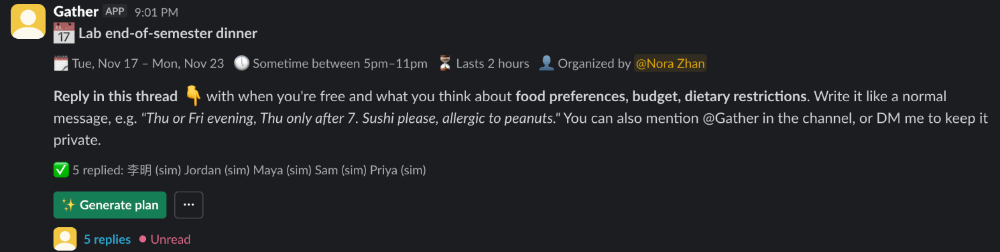
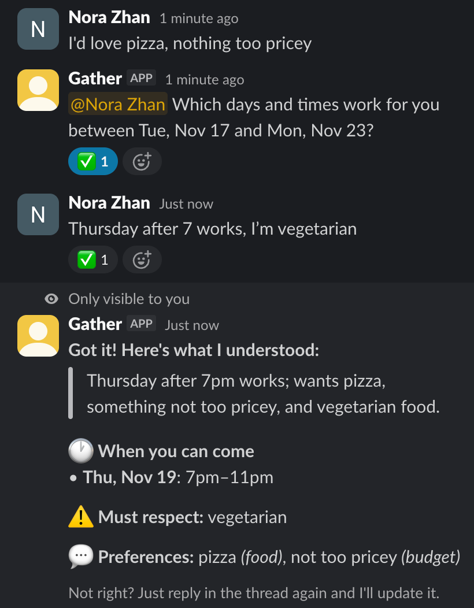
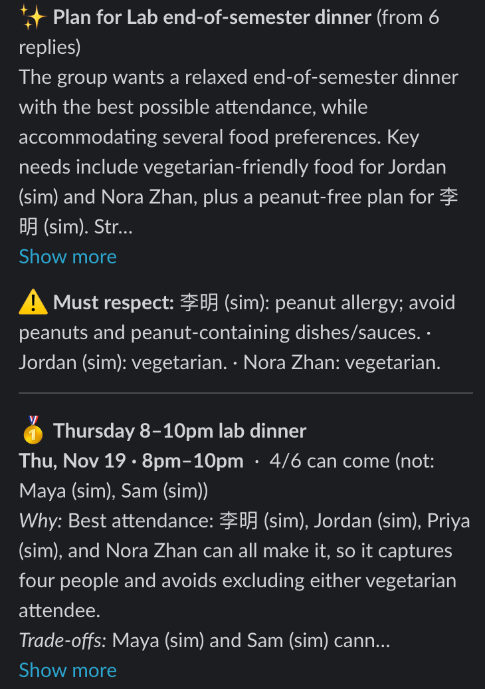
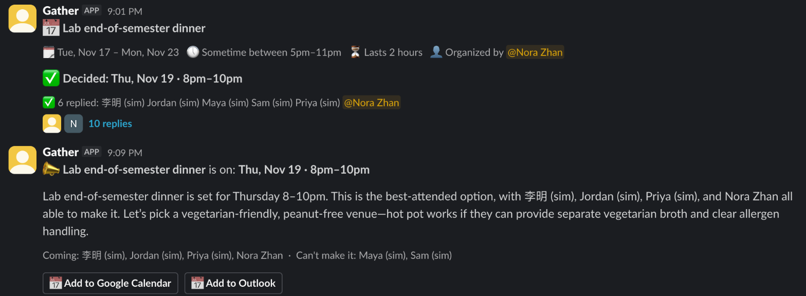
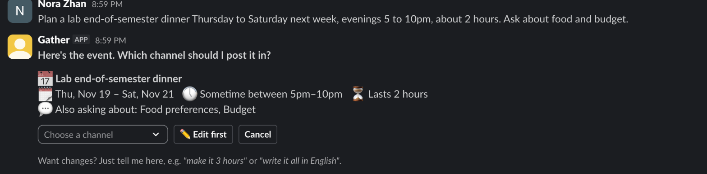
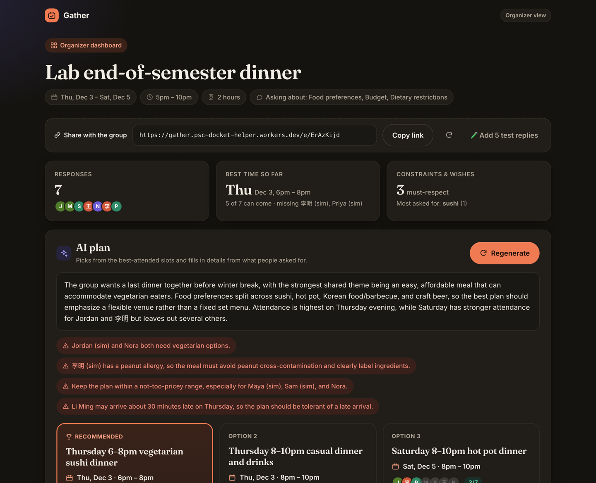
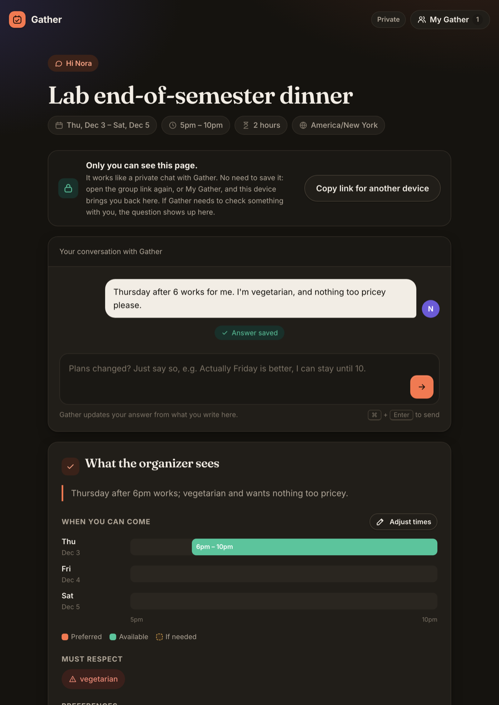

  

<h1 align="center">Gather</h1>

<b>Find a time that works for everyone, without a poll.</b> 
Everyone says when they're free and what they'd like in their own words. Gather turns it into a plan the whole group can live with.

---

## Add Gather to your Slack

Open **[Gather for Slack](https://gather.psc-docket-helper.workers.dev/slack)**, click **Add to Slack**, and approve the permissions. There's nothing to install and no server to run.

- Then type `/gather` in any channel, or message Gather under **Apps** in the sidebar.
- Some workspaces need an admin to approve new apps.
- Each workspace's data is stored separately; other organizations can't see your events or replies.
- To remove Gather, uninstall it from your workspace's app settings.
- When a new feature needs a new permission, organizers see a one-click **update** link. Existing events stay as they are.

No Slack? Use the **[web version](#no-slack-use-the-web-version)**.

---

## Why not a poll?

A poll lets you pick "Thursday evening," but not "Thursday works, but only after 7." Food, budget, and allergies get asked separately, and some people never answer. With Gather, people reply the way they'd normally talk:

> "Thursday or Friday evening both work, Thursday only after 7. I'd love Japanese food, nothing too pricey. Allergic to peanuts."

Gather reads each reply, finds the time the most people can make, and proposes two or three plans that account for everyone's preferences. If someone can't make the best time, it privately asks whether they could adjust.

---

## How it works in Slack

**Participants**

- **Reply in the event's thread** in your own words, in any language. You can also mention **@Gather** in the channel. If you reply in the channel without mentioning it, Gather asks you privately whether to count it.
- **If something's unclear**, such as no time given, Gather asks a short follow-up, at most twice.
- **You get a confirmation card** only you can see. If it got something wrong or your plans change, just reply again.
- **Prefer privacy?** Message Gather directly, for example "I don't drink" or "I have a doctor's appointment that day."
- **Gather may ask you privately** whether you could make the time most people picked. Saying no is completely fine.

**Organizers**

1. **Start an event** with `/gather Lab dinner` and a short form, or with one sentence to Gather: "Plan a happy hour next week in #social, evenings, about 2 hours." Reply in plain words to adjust the draft, then pick a channel to post it.
2. **Wait for replies.** The event message shows who has replied. Use **⋯ → 🔔 Remind who hasn't replied** to nudge people, or **⋯ → 🚫 Cancel this event**. A private web dashboard shows a heatmap of who is free when.
3. **Click ✨ Generate plan** for two or three proposals, each with who can come, why, the trade-offs, and suggestions for the venue and budget.
4. **Optional: click 🤝 Ask the people who can't make it.** Gather asks each of them privately and reports back.
5. **Click 📣 Announce.** Gather posts the decision with **Add to Google Calendar** and **Add to Outlook** buttons, and the event stops collecting replies.

  
  

**Try it alone first:** **⋯ → 🧪 Add 5 test replies** adds made-up participants (marked "sim") who write in different styles and languages, so you can run the whole flow by yourself.

**Gather remembers your habits.** Tell it something like "reply to me in Chinese, but post events in English" or "I usually post in #social," and it applies that from then on. It always tells you what it remembered; ask "What do you remember about me?" to check, or "forget my preferences" to clear it.

---

## No Slack? Use the web version

**[gather.psc-docket-helper.workers.dev](https://gather.psc-docket-helper.workers.dev)** works for any group chat, such as WhatsApp. Create an event, share the link, and everyone replies with a sentence.

- **Organizers** get a private dashboard with a heatmap, ranked time slots, and the AI plan, plus a ready-made message to paste back into the group.
- **Each participant gets a private page**, the web version of a Slack direct message. They can update their answer in words, or tap **Adjust times** and drag across the day bars. If Gather has a follow-up question, it appears there.
- **Nothing to save.** The device remembers each person, so opening the group link again brings them back to their page. **My Gather** (`/me`) lists every event that device has replied to.
- A website can't send notifications, so the dashboard has a **Copy a reminder** button for anyone Gather is waiting on.

The web version's pages and Gather's replies are in English, but it understands replies in any language.

---

## Privacy

| What | Who can see it |
|---|---|
| What you write in an event thread | Everyone in the channel |
| Direct messages to Gather, your private web page | Only you (and Gather) |
| The summary of your reply (times, needs, preferences) | The organizer |
| Who has replied | Everyone in the channel or group (names only) |

---

## For developers

Gather runs on Cloudflare Workers, with one Durable Object per web event and per Slack workspace. An LLM reads replies into structured availability and preferences; the time slots are ranked by code, never invented by the model. To run it locally or deploy your own copy, see the **[development guide](docs/DEVELOPMENT.md)** (in Chinese).
